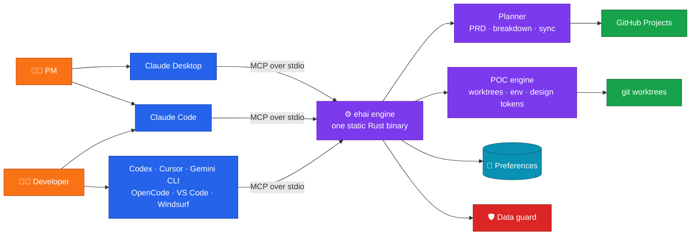
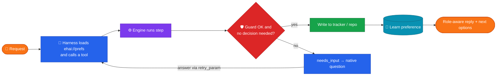

# ehai — AI-SDLC Operations Engine

[](LICENSE)
[](CHANGELOG.md)
[](https://github.com/jagadeeshm007/ehai/actions/workflows/ci.yml)
[](https://jagadeeshm007.github.io/ehai/)

> **One tool. Every AI harness. Plan → track → ship.**

ehai connects your AI coding tool to your project tracker and codebase, so product managers can go from idea to GitHub Project items without touching a terminal, and developers can carry tasks through the full dev lifecycle — branch, PR, done — without leaving their AI harness.

```bash
curl -fsSL https://raw.githubusercontent.com/jagadeeshm007/ehai/main/install/install.sh | sh
```

---

## The problem

AI coding assistants made *writing code* fast, but everything around the code is still manual:

- PMs retype requirements from docs and chats into the tracker by hand.
- Every AI tool (Claude Code, Codex, Cursor, Gemini CLI…) needs its own setup, so a team cannot share one workflow.
- Developers jump between tracker, terminal and AI chat to start a task, open a PR and move the card.
- Trying a UI idea risks `main`, and a fresh worktree will not even run (no `.env`, no deps, port clashes).
- Sensitive data slips into tickets, and the AI asks the same questions every session.

## Why ehai?

| Without ehai | With ehai |
|---|---|
| Copy requirements from Notion into GitHub manually | `/ehai:plan` → PRD → breakdown → GitHub Project in one session |
| Context-switch between JIRA, Slack, and your IDE | `/ehai:start #42` loads the task, creates the branch, sets In Progress |
| Prototype in a branch that breaks main | `/ehai:poc new "..."` creates an isolated worktree that never touches main |
| Paste PHI into a tracker comment by accident | Built-in data policy guard blocks it before it lands anywhere |
| `npm install` fails in every fresh worktree | Auto-provisioned `.env`, deps, and ports on every POC |
| The AI asks the same questions every time | Preferences are learned, become defaults, and stay editable |

---

## Philosophy

- **One engine, thin adapters** — all logic lives in one Rust binary; each AI harness only gets generated config that calls the same MCP tools.
- **Main is sacred** — POCs live in separate worktrees and are never merged or pushed unless you ask.
- **Never break, always run** — atomic updates with automatic rollback, versioned config, additive-only tool schemas, panic-safe server.
- **Ask, don't guess** — detect what can be detected; ask the rest through the harness's native multiple-choice UI.
- **Learn and adapt** — observed choices become defaults; explicit statements always win.
- **Safe by default** — data guard on every write, sandboxed agent work, secrets never sent to the tracker, logs or the LLM.

---

## How it works



### The agent loop

When a tool needs a decision, it returns a `needs_input` question instead of guessing. The harness asks it in its own multiple-choice UI and calls the tool again with the answer.



The engine is a single static Rust binary (12 crates, `rmcp` MCP server, GitHub Projects v2 over GraphQL, system `git` for worktrees). No Node, Python, or Docker required to run it.

**Full walkthrough** — the PM flow, POC pipeline, worktree env pipeline, preference learning and safe updates, all with diagrams: [How ehai works](https://jagadeeshm007.github.io/ehai/guide/how-it-works/) ([source](docs/guide/how-it-works.md)).

---

## Quickstart

**Requirements**

| Needed | For | Notes |
|---|---|---|
| macOS 12+, Windows 10 1809+, or Linux 5.13+ (x86_64 or arm64; Windows x86_64) | everything | One static binary, no runtime to install |
| `curl`, `tar` and `sha256sum` or `shasum` | installer | Already on macOS and almost every Linux. Windows uses built-in PowerShell |
| `git` 2.20+ | POCs, worktrees, `/ehai:start` | `ehai doctor` checks it |
| `gh` **or** a `GITHUB_TOKEN` | GitHub Projects tracker | ehai reuses `gh auth token`; without `gh`, set `GITHUB_TOKEN` (or `GH_TOKEN`). Not needed for the local tracker |
| Chrome / Chromium | optional | POC screenshots only; skipped if missing |
| Your project's own tools (`pnpm`/`npm`/`yarn`/`bun`, `go`, `uv`/`poetry`/`pip`) | optional | Only to install dependencies and run previews inside POC worktrees |

Not needed: Node, Python, Docker or `minisign` (the installer gets a temporary copy to check the signature).

**Step 1 — Install**

```bash
# macOS / Linux
curl -fsSL https://raw.githubusercontent.com/jagadeeshm007/ehai/main/install/install.sh | sh

# Windows (PowerShell)
irm https://raw.githubusercontent.com/jagadeeshm007/ehai/main/install/install.ps1 | iex

# From source
cargo build --release && ./target/release/ehai self install
```

**Step 2 — Init** (runs in under 2 minutes, asks at most 5 questions)

```bash
ehai init
```

The wizard auto-detects your OS, installed AI harnesses, GitHub auth, and current repo. It wires up MCP, slash commands, and your tracker automatically.

**Step 3 — Use it**

```
/ehai:plan  A notifications settings screen for mobile users
```

ehai interviews you, produces a full PRD, runs a gap-finder loop, and waits for your approval before generating a breakdown and syncing to your tracker.

---

## Use Cases

### Product Managers

**Idea → GitHub Project items in one session**

```
PM:  /ehai:plan  Users need to control which push notifications they receive
     ↓ ehai asks 3-4 clarifying questions
     ↓ produces PRD with Mermaid user flows
     ↓ auto-runs gap check (missing metrics? missing edge cases?)

PM:  /ehai:breakdown
     ↓ PRD → 3 epics, 11 stories, acceptance criteria for each

PM:  /ehai:sync
     ↓ 11 items created in GitHub Projects, never duplicated on re-run
```

**Daily status report**

```
PM:  /ehai:status
     → 68% done on Notifications epic (8/11 tasks)
     → 2 items stale (no update in 5 days): #34, #41
     → 1 open PR awaiting review: #22 "Notification toggle component"
     → Risk: "iOS silent push cert expires in 14 days"
```

**Bug triage**

```
PM:  /ehai:triage  "App crashes when user has 0 notification prefs saved"
     → Type: Bug  Priority: P1  Size: S
     → Similar existing: #38 "Crash on empty prefs" — is this the same?
PM:  New item
     → Created #51 in tracker
```

---

### Developers

**Start a task**

```
Dev: /ehai:start #42
     → Branch feat/42-notification-toggle created
     → Task context loaded (acceptance criteria, design notes)
     → Card set to In Progress
```

**Open a PR**

```
Dev: /ehai:pr
     → PR description drafted with acceptance criteria checklist
     → Links #42 in body
     → Card moved to In Review
```

**Generate an isolated UI prototype**

```
Dev: /ehai:poc new "notification toggle screen"
     → Worktree created at ~/.ehai/worktrees/<repo>/notifications/poc-1
     → Design tokens extracted from your existing app (Tailwind, NativeWind, etc.)
     → .env, node_modules, ports provisioned automatically
     → Dev server started on port 3042
     → Screenshot captured
```

**Iterate and compose**

```
Dev: /ehai:poc iterate poc-1 "Make the toggle bigger and add a subtitle"
     → poc-2 created, lineage recorded

Dev: /ehai:poc compose "Take the layout from poc-1, toggles from poc-2"
     → poc-3 synthesised from both parents
     → Side-by-side screenshot gallery: http://localhost:3043/compare
```

---

### Operations

**Health check**

```bash
ehai doctor
# ✔ binary v0.1.0-alpha.2
# ✔ config valid (global + repo)
# ✔ GitHub auth (jagadeeshm007, project scope)
# ✔ tracker reachable (My Project · 23 items)
# ✔ Claude Code adapter installed
# ✔ port registry clean
# ✘ Gemini CLI adapter: config file not found at ~/.gemini/settings.json
#   → run: ehai connect gemini
```

**Update**

```bash
ehai update                  # check configured channel, verify, swap, auto-rollback if health check fails
ehai update --channel beta   # one-off channel override
ehai update --rollback       # restore previous binary
```

**Logs and audit**

```
~/.ehai/logs/           JSON logs (rotated daily, 7-day retention)
~/.ehai/audit/          Compliance decisions (kind + count only, never values)
```

**Move to a new machine**

```bash
# old machine
ehai migration export            # → ehai-backup-20261118.zip

# new machine (after installing ehai)
ehai migration import ehai-backup-*.zip
ehai adapters regenerate         # re-wires harnesses with new machine's paths
```

---

## Connecting ehai to your services

### GitHub

ehai needs a GitHub token with `project` scope to manage GitHub Projects.

**Option A — gh CLI (recommended)**

```bash
gh auth login                          # first-time login
gh auth refresh -s project             # add project scope if already logged in
```

ehai picks this up automatically via `gh auth token`.

**Option B — Environment variable**

```bash
export GITHUB_TOKEN=ghp_xxxxxxxxxxxx   # or GH_TOKEN
```

**Option C — No GitHub account**

Choose **local tracker** at `ehai init`. All PM flows work offline. Add GitHub later:

```bash
ehai tracker set github
```

**Verify**

```bash
ehai doctor        # shows "✔ GitHub auth" if everything is wired
```

---

### Claude Code

After `ehai init`, Claude Code is wired automatically. The MCP server runs as a user-scope server over stdio.

**Manual wiring**

```bash
ehai connect claude-code
# or via claude CLI directly:
claude mcp add --scope user ehai -- ehai mcp
```

**Verify in Claude Code**

```
/ehai:help          # lists all commands
/ehai:ping          # → {"ok": true, "version": "0.1.0-alpha.2"}
```

---

### Claude Desktop

```bash
ehai connect claude-desktop
# uploads settings to ~/Library/Application Support/Claude/claude_desktop_config.json
# generates skills ZIP at ~/.ehai/adapters/claude-desktop/ehai-skills.zip
```

Then in Claude Desktop → Settings → Skills → Upload ZIP.

This makes `/ehai:plan`, `/ehai:breakdown`, `/ehai:sync`, `/ehai:status`, and `/ehai:triage` available as first-class Skills in the Claude Desktop UI.

---

### OpenAI-compatible APIs

ehai's engine is model-agnostic — it doesn't call any LLM directly. The AI reasoning happens inside your harness (Claude Code, Codex, Cursor, etc.). ehai only exposes MCP tools that the harness calls. So any harness that supports MCP and is connected to any OpenAI-compatible API works with ehai out of the box.

Configure your harness's model/API endpoint as usual, then run `ehai init` or `ehai connect <harness>`.

---

### Other AI Harnesses

| Harness | Command | Config location |
|---|---|---|
| Codex CLI | `ehai connect codex` | `~/.codex/config.toml` |
| Gemini CLI | `ehai connect gemini` | `~/.gemini/settings.json` |
| Cursor | `ehai connect cursor` | `~/.cursor/mcp.json` |
| OpenCode | `ehai connect opencode` | `~/.config/opencode/config.json` |
| VS Code / Copilot | `ehai connect vscode` | user `mcp.json` |
| Windsurf | `ehai connect windsurf` | `~/.codeium/windsurf/mcp_server_config.json` |
| Any other | `ehai connect agents-md` | `~/AGENTS.md` reference card |

**List connected harnesses**

```bash
ehai adapters list
```

**Disconnect**

```bash
ehai disconnect cursor
ehai disconnect --all
```

---

## Skills & Slash Commands

Skills are the user-facing layer. Each `/ehai:<command>` is a skill that calls one or more MCP tools and handles the question-answer loop for you.

### PM Skills

| Skill | Trigger | What happens |
|---|---|---|
| `plan` | `/ehai:plan [idea]` | Multi-turn interview → PRD (problem, users, goals, flows, metrics, risks) → auto gap-finder loop → awaits breakdown approval |
| `breakdown` | `/ehai:breakdown` | PRD → epics → stories → tasks with Given/When/Then acceptance criteria → board preview → awaits sync approval |
| `sync` | `/ehai:sync` | Push approved breakdown to tracker idempotently; never duplicates; uses `ehai-id` footer tag |
| `status` | `/ehai:status` | % done per epic, blockers, stale items, open PRs, risk flags; outputs Markdown + Mermaid + optional HTML report |
| `triage` | `/ehai:triage [report]` | Classify type/priority/size, duplicate detection against existing items, create tracker item |
| `assign` | `/ehai:assign [request]` | Assign, reassign, or take a tracker item by name or number |
| `prefs` | `/ehai:prefs` | View and edit your role and learned preferences |

### Developer Skills

| Skill | Trigger | What happens |
|---|---|---|
| `next` | `/ehai:next` | Suggests the next task by priority and unblocked dependencies |
| `start` | `/ehai:start #id` | Creates `feat/<id>-<slug>` branch, loads task context + acceptance criteria, sets In Progress |
| `pr` | `/ehai:pr` | Drafts PR description linking the issue, maps changes to acceptance criteria, adds checklist; moves card to In Review |
| `done` | `/ehai:done` | Verifies acceptance criteria satisfied, moves card to Done |

### POC Skills

| Skill | Trigger | What happens |
|---|---|---|
| `poc new` | `/ehai:poc new "<idea>"` | Creates `poc-1`: isolated worktree, design context extracted, dev server started |
| `poc iterate` | `/ehai:poc iterate <pocN> "<feedback>"` | Iterates → `pocN+1`; lineage recorded |
| `poc compose` | `/ehai:poc compose "<take X from poc1, Y from poc2>"` | Synthesises a new POC from multiple parents; AI reads referenced diffs |
| `poc list` | `/ehai:poc list` | Lists all POCs with status (draft / liked / rejected / promoted / archived) |
| `poc compare` | `/ehai:poc compare [pocA pocB …]` | Side-by-side screenshot gallery + diff summary |
| `poc open` | `/ehai:poc open <pocN>` | Starts the POC's dev server |
| `poc promote` | `/ehai:poc promote <pocN>` | Opens a PR to the default branch after explicit confirmation |
| `poc discard` | `/ehai:poc discard <pocN>` | Archives as git tag `ehai-archive/<feature>/<pocN>`, removes worktree |

---

## MCP Tools Reference

The MCP server exposes tools that skills call automatically. You can also call them directly in any MCP-compatible client.

### `ping`

Health check for the MCP server.

**Parameters:** none

**Response**
```json
{ "status": "ok", "version": "0.1.0-alpha.2" }
```

---

### `save_prd`

Store a Product Requirements Document. Runs the data policy guard before writing. Automatically triggers `plan_explore` after a successful save.

**Parameters**

| Name | Type | Required | Description |
|---|---|---|---|
| `prd` | `Prd` object | yes | The document (see PRD schema below) |
| `repo_path` | string | no | Write `docs/prd/<slug>.md` here too; defaults to current repo |
| `policy` | `"redact"` \| `"keep"` \| `"cancel"` | no | Answer to a pending sensitive-data question |

**PRD object schema**

| Field | Type | Required |
|---|---|---|
| `slug` | string | yes — URL-safe identifier |
| `title` | string | yes |
| `problem` | string | yes |
| `users` | string[] | yes |
| `goals` | string[] | yes |
| `out_of_scope` | string[] | yes |
| `flows` | `{name, steps[]}[]` | yes |
| `metrics` | `{name, target}[]` | yes |
| `risks` | `{description, mitigation}[]` | yes |

**Response**
```json
{ "status": "ok", "slug": "notifications-mvp", "gaps": [] }
```

**When to use:** Call via `/ehai:plan`. Call directly when integrating ehai into a custom CI/agent workflow.

---

### `get_plan`

Retrieve a saved PRD by slug.

**Parameters**

| Name | Type | Required | Description |
|---|---|---|---|
| `prd` | string | yes | The PRD slug |

**Response**
```json
{ "status": "ok", "prd": { ... } }
```

---

### `list_plans`

List all saved PRDs.

**Parameters:** none

**Response**
```json
{
  "status": "ok",
  "plans": [
    { "slug": "notifications-mvp", "title": "Notification Preferences", "created_at": "2026-11-18" }
  ]
}
```

---

### `save_breakdown`

Store an epic/story/task breakdown linked to a PRD.

**Parameters**

| Name | Type | Required | Description |
|---|---|---|---|
| `breakdown` | `Breakdown` object | yes | Epics with nested stories and tasks |
| `policy` | `"redact"` \| `"keep"` \| `"cancel"` | no | Sensitive-data question answer |

**Response**
```json
{ "status": "ok", "epics": 3, "stories": 11, "tasks": 28 }
```

---

### `sync_plan`

Push a breakdown to the connected tracker, idempotently.

**Parameters**

| Name | Type | Required | Description |
|---|---|---|---|
| `prd` | string | yes | PRD slug whose breakdown to sync |
| `apply` | boolean | no | `false` (default): dry-run preview. `true`: write to tracker |
| `policy` | string | no | Sensitive-data question answer |

**Response (dry run)**
```json
{ "status": "preview", "create": 8, "update": 3, "skip": 0 }
```

**Response (applied)**
```json
{ "status": "ok", "created": 8, "updated": 3, "skipped": 0 }
```

---

### `status_report`

Generate a progress report across all epics.

**Parameters**

| Name | Type | Required | Description |
|---|---|---|---|
| `html` | boolean | no | Also write an HTML report to `~/.ehai/reports/`; returns its path |

**Response**
```json
{
  "status": "ok",
  "epics": [
    { "name": "Notification Preferences", "done": 8, "total": 11, "pct": 73 }
  ],
  "stale": ["#34", "#41"],
  "open_prs": ["#22"],
  "risks": ["iOS silent push cert expires in 14 days"]
}
```

---

### `triage`

Classify a bug report or feature request and create a tracker item.

**Parameters**

| Name | Type | Required | Description |
|---|---|---|---|
| `title` | string | yes | Short title for the item |
| `description` | string | yes | Full description, steps to reproduce, or acceptance criteria |
| `kind` | `"bug"` \| `"story"` \| `"task"` | yes | Item type |
| `priority` | `"p0"` \| `"p1"` \| `"p2"` \| `"p3"` | yes | Severity |
| `size` | `"xs"` \| `"s"` \| `"m"` \| `"l"` \| `"xl"` | no | Effort estimate |
| `decision` | string | no | `"new"` or `"dup:<id>"` — answer to a duplicate question |
| `policy` | string | no | Sensitive-data question answer |

**Response**
```json
{ "status": "ok", "id": "ITEM-51", "url": "https://github.com/..." }
```

---

### `plan_explore`

Run a structured gap check on a PRD draft. Returns the top-5 gaps as questions. Called automatically after `save_prd`; call directly for a mid-session check.

**Parameters**

| Name | Type | Required | Description |
|---|---|---|---|
| `slug` | string | yes | PRD slug to analyse |
| `round` | integer | no | Current round number (1–3); stops after 3 |
| `answers` | `{question_id, answer}[]` | no | Answers from a previous round to merge into the PRD |
| `policy` | string | no | Sensitive-data question answer |

**Response**
```json
{
  "status": "ok",
  "gaps": [
    { "id": "g1", "description": "No error/edge-case flow", "question": "What happens when the user has no internet?" }
  ],
  "round": 1,
  "complete": false
}
```

---

### `guard_check`

Scan text for sensitive data. Never stores values — returns kinds and counts only.

**Parameters**

| Name | Type | Required | Description |
|---|---|---|---|
| `text` | string | yes | Text to scan |

**Response**
```json
{
  "status": "ok",
  "findings": [
    { "kind": "ssn", "count": 1, "confidence": "High" },
    { "kind": "email", "count": 2, "confidence": "High" }
  ],
  "redacted": "SSN [REDACTED:ssn] on file for [REDACTED:email] and [REDACTED:email]"
}
```

---

### `assign_task`

Assign a tracker item to one or more team members.

**Parameters**

| Name | Type | Required | Description |
|---|---|---|---|
| `item` | string | yes | `#18`, a URL, an ehai id, or part of the title |
| `assignees` | string[] | yes | GitHub logins, or `"me"` for the caller |
| `mode` | `"add"` \| `"replace"` \| `"remove"` | no | Default: `"add"` |

**Response**
```json
{ "status": "ok", "item": "ITEM-18", "assignees": ["priya", "jagadeesh"] }
```

---

### `comment_task`

Post a comment on a tracker item, with optional @mentions.

**Parameters**

| Name | Type | Required | Description |
|---|---|---|---|
| `item` | string | yes | Item reference |
| `body` | string | yes | Comment body (Markdown supported) |
| `mentions` | string[] | no | Logins to prepend as `@login` mentions |
| `policy` | string | no | Sensitive-data question answer |

**Response**
```json
{ "status": "ok", "comment_url": "https://github.com/..." }
```

---

### `team`

List the project team (GitHub assignable users, cached for up to 24 hours).

**Parameters**

| Name | Type | Required | Description |
|---|---|---|---|
| `refresh` | boolean | no | Force a cache refresh |

**Response**
```json
{ "status": "ok", "members": [{ "login": "priya", "name": "Priya Sharma", "role": "admin" }] }
```

---

### `needs_input` response

When a tool needs a user decision before proceeding, it returns:

```json
{
  "status": "needs_input",
  "header": "Sensitive data",
  "question": "Found ssn ×1, email ×2. How should ehai handle this?",
  "options": [
    { "label": "Redact", "value": "redact", "description": "Replace with [REDACTED:kind]" },
    { "label": "Keep", "value": "keep", "description": "Write as-is" },
    { "label": "Cancel", "value": "cancel", "description": "Don't write anything" }
  ],
  "multi_select": false,
  "retry_param": "policy"
}
```

Call the same tool again with `retry_param` set to the chosen `value`.

---

## Configuration

Layered merge — narrower wins: `defaults < ~/.ehai/config.toml < .ehai.toml (repo) < EHAI_SECTION__KEY env < CLI flags`

```toml
# ~/.ehai/config.toml

[brand]
name = "ehai"           # rename binary and all slash commands

[compliance]
mode    = "warn"        # off | warn | strict
profile = "tech"        # tech | health | finance | gdpr
patterns = []           # [{name="my-id", regex="\\bMY-\\d{6}\\b"}]

[sandbox]
mode = "restricted"     # off | restricted | container

[update]
channel = "alpha"       # alpha | beta | stable
auto    = false

[tracker]
type    = "github"      # github | local
project = "My Project"
```

Full reference: [docs/reference/config.md](https://jagadeeshm007.github.io/ehai/reference/config/)

---

## Documentation

| Resource | Description |
|---|---|
| [jagadeeshm007.github.io/ehai](https://jagadeeshm007.github.io/ehai/) | Full docs site (quickstart, guides, reference). Every page has a **Copy Markdown** button to paste it into an AI agent. |
| [How ehai works](docs/guide/how-it-works.md) | Problem, philosophy, architecture and flow diagrams |
| [docs/PROGRESS.md](docs/PROGRESS.md) | Milestone log |
| [docs/DECISIONS.md](docs/DECISIONS.md) | ADR log |
| [CONTRIBUTING.md](CONTRIBUTING.md) | Dev setup, branch naming, PR process |
| [CHANGELOG.md](CHANGELOG.md) | Release history |

---

## Contributing

ehai is MIT-licensed and open to contributions. See [CONTRIBUTING.md](CONTRIBUTING.md) for the full guide.

**Quick start for contributors**

```bash
git clone https://github.com/jagadeeshm007/ehai
cd ehai
cargo build --workspace
cargo nextest run --workspace
```

Good first issues are tagged [`good first issue`](https://github.com/jagadeeshm007/ehai/labels/good%20first%20issue) on GitHub.

---

## License

MIT © JagadeeshMandala, 2026 — see [LICENSE](LICENSE).
