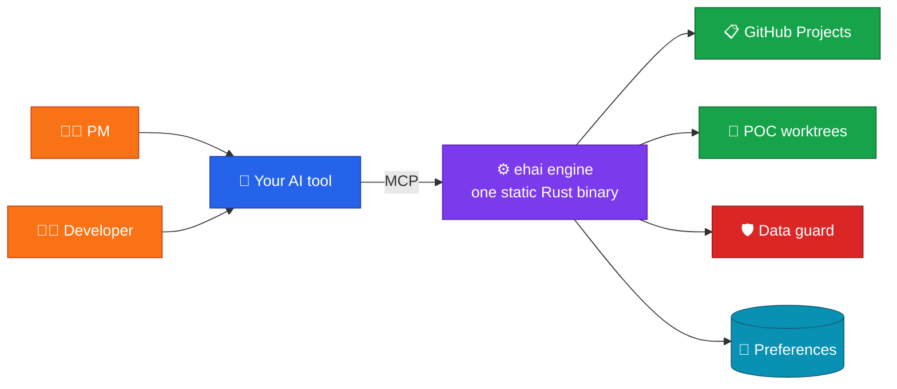

# ehai — AI-SDLC Operations Engine

[](LICENSE)
[](CHANGELOG.md)
[](https://github.com/jagadeeshm007/ehai/actions/workflows/ci.yml)
[](https://jagadeeshm007.github.io/ehai/)

> **One tool. Every AI harness. Plan → track → improve.**

ehai connects your AI coding tool (Claude Code, Claude Desktop, Codex, Cursor, Gemini CLI, Copilot and others) to your GitHub Project and your codebase. PMs go from idea to tasks on the board in one conversation. Everyone can try UI ideas in isolated POCs that never touch `main`.

```bash
curl -fsSL https://raw.githubusercontent.com/jagadeeshm007/ehai/main/install/install.sh | sh
```

**[Documentation →](https://jagadeeshm007.github.io/ehai/)**

---

## Why ehai

| Without ehai | With ehai |
|---|---|
| Requirements retyped from docs and chats into the tracker | `/ehai:plan` → PRD → `/ehai:breakdown` → `/ehai:sync`, without duplicates on re-sync |
| Each AI tool set up differently; no shared team workflow | One engine; every AI tool gets the same commands |
| Prototypes risk `main`, and fresh worktrees don't run | `ehai poc new` gives an isolated worktree with `.env`, deps and its own ports |
| Sensitive data slips into tickets | A data policy guard checks every write first |
| The AI asks the same questions every session | Preferences are learned, become defaults, and stay editable |

## How it works



All logic lives in one binary with no Node, Python or Docker needed. Your AI tool does the reasoning and calls ehai's tools over MCP. When a decision belongs to you, ehai asks through your tool's multiple-choice UI instead of guessing. More in [How ehai works](https://jagadeeshm007.github.io/ehai/guide/how-it-works/).

## Quickstart

```bash
# 1. Install (macOS / Linux). Windows: irm https://raw.githubusercontent.com/jagadeeshm007/ehai/main/install/install.ps1 | iex
curl -fsSL https://raw.githubusercontent.com/jagadeeshm007/ehai/main/install/install.sh | sh

# 2. Set up: detects your AI tools, GitHub login and repo; asks at most 5 questions
ehai init
```

```
# 3. In your AI tool
/ehai:plan  A notifications settings screen for mobile users
```

`ehai` works in the same terminal right after install. You need `git` and either `gh` or a `GITHUB_TOKEN`. Full requirements: [Quickstart](https://jagadeeshm007.github.io/ehai/guide/quickstart/).

## What you can do

| Command | What it does |
|---|---|
| `/ehai:plan` | Interviews you and writes a PRD: goals, flows as diagrams, metrics, risks |
| `/ehai:breakdown` | PRD → epics, stories, tasks with Given/When/Then, sizes and dependencies |
| `/ehai:sync` | Pushes the breakdown to GitHub Projects; re-running never duplicates |
| `/ehai:status` | Progress per epic, blockers, stale items, risks |
| `/ehai:triage` | Turns a bug report into a prioritised item, checking for duplicates first |
| `/ehai:assign` | Assigns, reassigns or takes a task |
| `/ehai:prefs` | Shows and edits your role and learned preferences |
| `ehai poc new / iterate / compare / promote` | UI prototypes in isolated worktrees that match your design system |
| `ehai poc run <feature> <n> [-- cmd]` | Runs a POC (or any command in it) from the repo root, with no `cd` |
| `ehai doctor` | Checks the install, config, GitHub access and connected AI tools |

Every reply ends with a short **★ Insights** footer: a summary, the next step and any warnings. Details: [Skills](https://jagadeeshm007.github.io/ehai/reference/skills/) · [MCP tools](https://jagadeeshm007.github.io/ehai/reference/mcp-tools/) · [Use cases](https://jagadeeshm007.github.io/ehai/guide/use-cases/).

## Works with spec-driven tools

Build the project with **[AWS AI-DLC](https://github.com/awslabs/aidlc-workflows)**, **[GitHub Spec Kit](https://github.com/github/spec-kit)** or **[Kiro specs](https://kiro.dev/docs/specs/)**. Then use ehai on top to put the work on the board, track and maintain it, and prototype improvements. See the [step-by-step recipes](https://jagadeeshm007.github.io/ehai/guide/spec-driven/).

## Supported AI tools

Claude Code · Claude Desktop · Codex CLI · Gemini CLI · Cursor · VS Code / Copilot · OpenCode · Windsurf · anything else via `AGENTS.md`.
`ehai init` sets them up; `ehai connect <tool>` or `ehai disconnect <tool>` changes them later. See [Setup & connections](https://jagadeeshm007.github.io/ehai/guide/setup/).

## Configuration

`~/.ehai/config.toml`, optionally overridden per repo by `.ehai.toml`:

```toml
[compliance]
mode    = "warn"     # off | warn | strict
profile = "tech"     # tech | health | finance | gdpr

[tracker]
type = "github"      # github | local
```

All keys: [Config reference](https://jagadeeshm007.github.io/ehai/reference/config/).

## Contributing

```bash
git clone https://github.com/jagadeeshm007/ehai && cd ehai
cargo build --workspace && cargo nextest run --workspace
```

See [CONTRIBUTING.md](CONTRIBUTING.md) · [Changelog](CHANGELOG.md) · [Decisions](docs/DECISIONS.md) · [Progress](docs/PROGRESS.md).

## License

MIT © JagadeeshMandala, 2026 — see [LICENSE](LICENSE).
