# How ehai works

This page covers why ehai exists, what problem it solves, the ideas behind it, how it is built, and how a request moves through it, with diagrams.

**Diagram colour key:** used the same way on every diagram below.

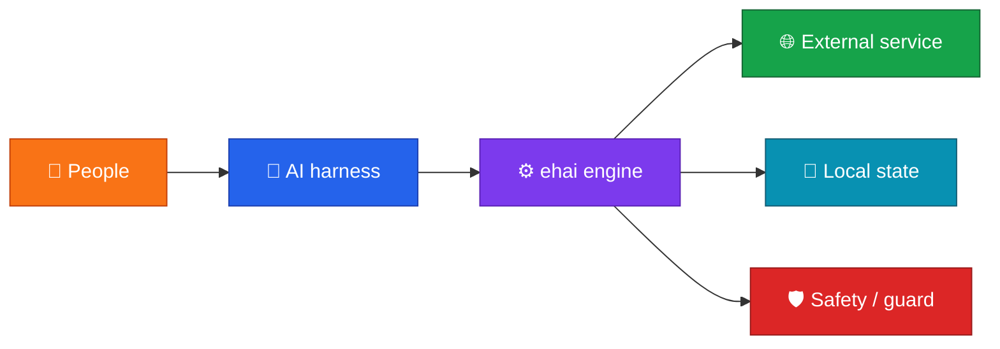

---

## 1. The problem

AI coding assistants made *writing code* fast. Everything around the code is still slow and manual:

| Pain | Who feels it | What it costs |
|---|---|---|
| Requirements live in docs and chats; someone retypes them into the tracker by hand | PM | Hours per feature, lost detail, duplicate issues |
| Every AI tool (Claude Code, Codex, Cursor, Gemini CLI…) needs its own setup, prompts and conventions | Developers | Inconsistent output; the team cannot share one workflow |
| A developer jumps between tracker, terminal and AI chat to start a task, open a PR and move the card | Developers | Context switching; stale boards |
| Trying a UI idea means a branch in the real repo, and a fresh worktree will not run (no `.env`, no deps, port clashes) | PM + Dev | Prototypes are slow, risky to `main`, or never built |
| Prototypes ignore the app's real colors, fonts and components | PM | POCs look nothing like the product, so feedback is poor |
| Someone pastes a customer email or ID into a ticket | Everyone | Compliance incidents |
| The AI asks the same questions every session | Everyone | It never learns how this team works |

## 2. How ehai helps

ehai is **one engine** that every AI harness talks to. It turns the AI from a code generator into a full **SDLC teammate**:

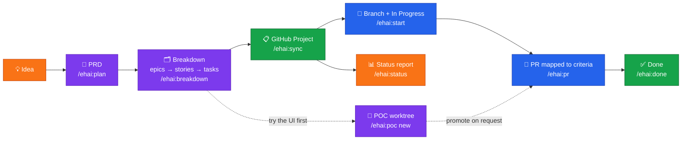

- **PMs** go from idea → PRD → approved tasks on the board in one conversation, in the Claude desktop app or Claude Code, without terminal commands.
- **Developers** pick, start, ship and close tasks from whichever AI tool they like. The branch, PR text and card moves are done for them.
- **Everyone** can ask for a UI prototype that uses the app's own design system and runs in an isolated copy of the repo, so `main` is never touched.
- **The guard** checks every tracker write, PRD and mock-data fixture for sensitive data first.
- **Preferences** make each session a little better than the last.

---

## 3. Philosophy

These rules decide every design trade-off in ehai.

| Principle | What it means in practice |
|---|---|
| **One engine, thin adapters** | All logic is in one Rust binary. Each harness gets only generated config and prompt files that call the same MCP tools, so a new AI tool costs one small adapter, not a rewrite. |
| **Main is sacred** | POCs live in separate worktrees on `ehai/poc/...` branches outside the repo. Nothing is merged, pushed or promoted unless you ask. |
| **Never break, always run** | Atomic updates with automatic rollback, versioned config with migrations, additive-only MCP schemas, and a per-request panic guard so one bad call never kills the server. |
| **Ask, don't guess** | Questions go through the harness's native multiple-choice UI. Anything that can be detected is detected instead of asked. Every question has a default. |
| **Learn and adapt** | Observed choices become preferences, which become defaults. Explicit statements always beat observations, and the user can edit or delete any of them. |
| **Safe by default** | Data guard on every write, sandboxed agent work, secrets never sent to the tracker, logs or the LLM (keys only, never values). |
| **Minimal footprint** | One static binary. No Node, Python or Docker to run it. No telemetry. `ehai uninstall` leaves no traces. |
| **Role-aware** | Same commands for everyone; PMs get plain language and visuals, developers get paths, diffs and commands. |

---

## 4. How it is built

### 4.1 Architecture

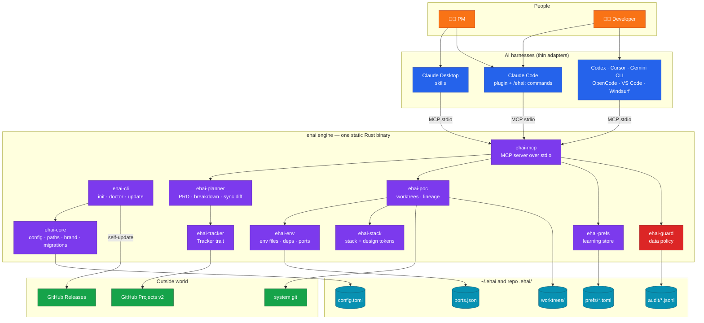

### 4.2 Tech choices

| Layer | Choice | Why |
|---|---|---|
| Language | Rust (stable), Cargo workspace of 12 crates | One static binary, no runtime to install, fast startup per MCP session |
| AI interface | MCP via `rmcp`, stdio transport | Every major harness speaks MCP; stdio means no daemon to crash |
| CLI + wizard | `clap`, `cliclack`, `indicatif`, `ratatui` | Guided, polished terminal UX; a `Prompter` trait keeps it testable |
| Tracker | `reqwest` (rustls) + GraphQL for GitHub Projects v2 | No OpenSSL; Projects v2 is GraphQL-only |
| Git | shells out to system `git` | Worktrees behave exactly as the user's own git does |
| Config | TOML + `serde` + `schemars` | Human-editable, with a generated JSON schema |
| Updates | `self-replace` + SHA-256 + minisign | Verified, atomic swap with rollback |
| Tests | `insta`, `wiremock`, `proptest`, `assert_cmd`, `nextest` | Snapshots for every generated file, mocked HTTP, property-tested migrations |

### 4.3 Config layering

Narrower settings win:

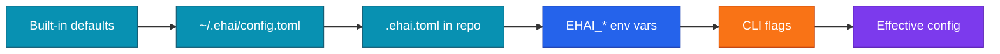

---

## 5. How a request flows

### 5.1 One tool call, end to end

The harness spawns `ehai mcp` per session. The engine loads your preferences, runs the tool, checks it with the guard, writes, and records what it learned.

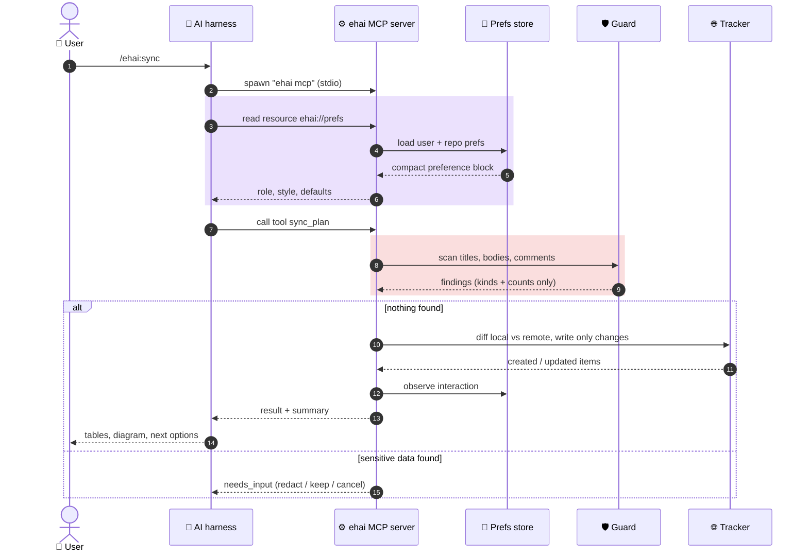

### 5.2 The agent loop (`needs_input`)

ehai never guesses on a decision that belongs to the user. When a tool cannot continue on its own, it returns a structured question instead of failing. The harness shows it in its native multiple-choice UI and calls the same tool again with the answer.

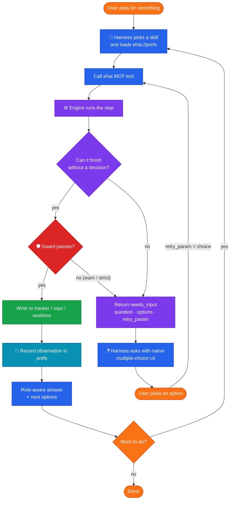

Because the loop goes through MCP, it works the same in every harness. Clients that support MCP elicitation get the question directly; others render the `needs_input` result.

### 5.3 PM planning flow

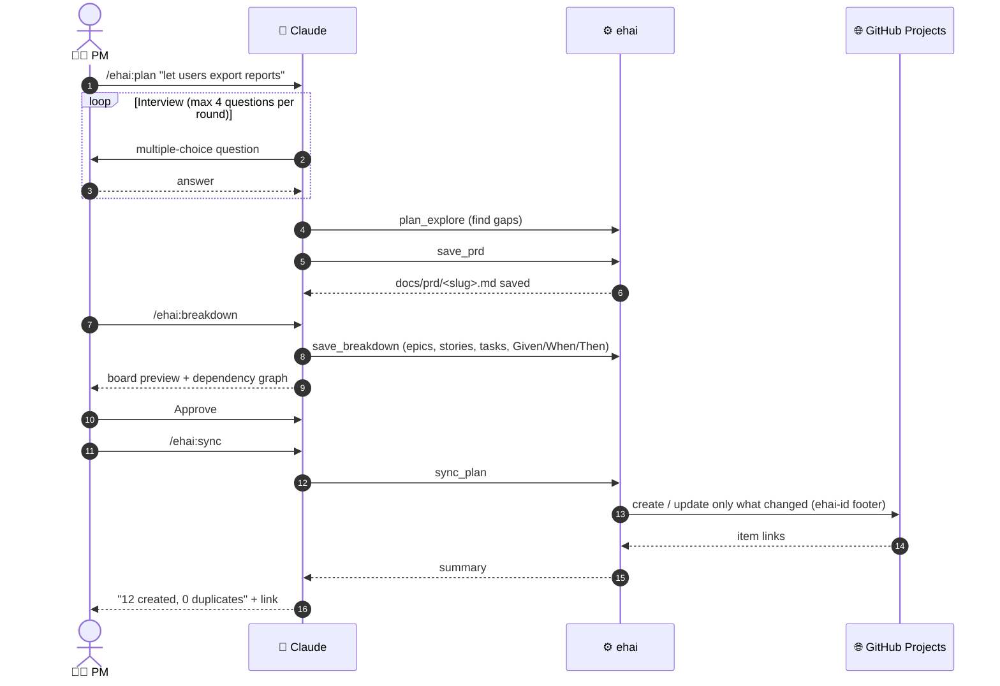

Re-running `/ehai:sync` never duplicates items: each issue carries a stable `ehai-id`, and ehai diffs local against remote first.

### 5.4 POC pipeline

```mermaid
flowchart LR
  req["💡 Idea / task"]:::user --> und["1 · Understand<br/>clarify if needed"]:::harness
  und --> ana["2 · Analyze codebase<br/>stack · design tokens<br/>components · navigation"]:::engine
  ana --> place["3 · Placement<br/>where it lives, what it reuses"]:::engine
  place --> wt["4 · Isolated worktree<br/>ehai/poc/feature/poc-n"]:::store
  wt --> envp["Env pipeline<br/>(section 5.5)"]:::engine
  envp --> build["5 · Build with existing<br/>components + mock data"]:::harness
  build --> prev["6 · Preview<br/>dev server + screenshots"]:::ext
  prev --> reg["7 · Register in manifest<br/>lineage · feedback"]:::store
  reg --> fb{"Feedback?"}:::user
  fb -- "iterate" --> build
  fb -- "compose poc1 + poc2" --> wt
  fb -- "promote (explicit)" --> pr["Open PR to default branch"]:::ext
  fb -- "discard" --> arc["Archive tag<br/>remove worktree"]:::store

  classDef user fill:#f97316,stroke:#c2410c,color:#fff
  classDef harness fill:#2563eb,stroke:#1e40af,color:#fff
  classDef engine fill:#7c3aed,stroke:#5b21b6,color:#fff
  classDef ext fill:#16a34a,stroke:#166534,color:#fff
  classDef store fill:#0891b2,stroke:#155e75,color:#fff
```

POC lineage is a graph. `compose` resynthesizes parts of several POCs on a fresh branch from the base, instead of cherry-picking:

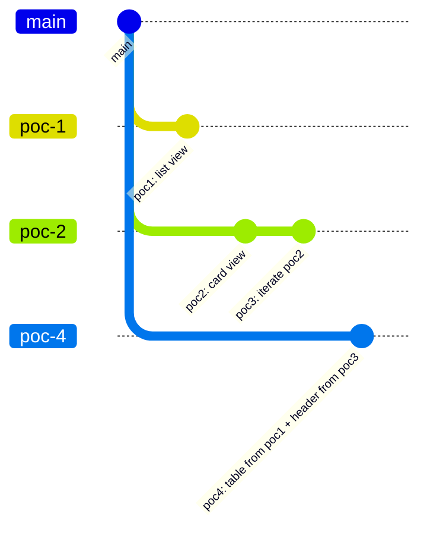

### 5.5 Worktree environment pipeline

A fresh worktree normally will not run. ehai makes it runnable:

```mermaid
flowchart LR
  a["1 · Discover<br/>gitignored .env*, local configs,<br/>keys from .env.example"]:::engine --> b["2 · Materialize<br/>copy or symlink"]:::engine
  b --> c["3 · Validate<br/>missing keys → ask"]:::harness
  c --> d["4 · Ports<br/>unique per worktree<br/>.env.ehai.local"]:::store
  d --> e["5 · Install deps<br/>pnpm / yarn / npm / bun<br/>go / uv / poetry / pip"]:::ext
  e --> f["6 · Health check<br/>smoke command"]:::engine
  f --> g["7 · Safety<br/>env files gitignored,<br/>values never leave"]:::guard
  g --> ok(["✅ Ready"]):::user

  classDef user fill:#f97316,stroke:#c2410c,color:#fff
  classDef harness fill:#2563eb,stroke:#1e40af,color:#fff
  classDef engine fill:#7c3aed,stroke:#5b21b6,color:#fff
  classDef ext fill:#16a34a,stroke:#166534,color:#fff
  classDef store fill:#0891b2,stroke:#155e75,color:#fff
  classDef guard fill:#dc2626,stroke:#991b1b,color:#fff
```

---

## 6. Preferences: how ehai learns

Each tool call can record an observation. Observations build confidence over time and become defaults; anything you state explicitly always wins.

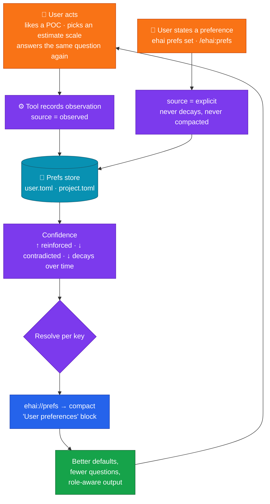

**Resolution order** (first match wins):

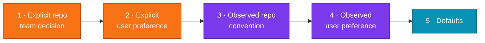

Preferences describe behavior only (counts, booleans, labels), never sensitive data. Turn learning off with `prefs.learning = false`. More detail: [User preference agent](../reference/user-preference-agent.md).

---

## 7. Updates that never break

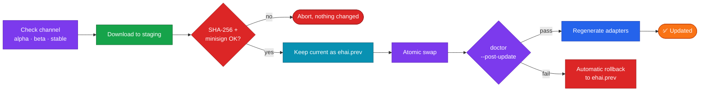

---

## Next

- [Quickstart](quickstart.md) — install and run `ehai init`
- [Use cases](use-cases.md) — PM, developer and POC walkthroughs
- [Data policy](compliance.md) — how the guard works
- [MCP tools](../reference/mcp-tools.md) — every tool the harness can call
