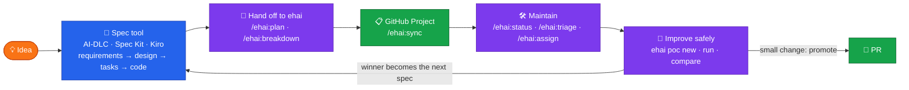
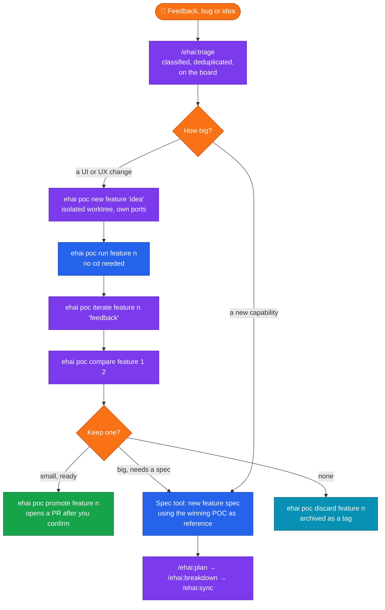

# Build with spec-driven tools, run it with ehai

Spec-driven tools are good at **creating** software. You describe what you want, they turn it into requirements, a design, tasks and code, and they stop for your approval along the way. Once the code exists, most of the work is **running and improving** it:

- keeping the team's board up to date,
- triaging bugs,
- knowing what is blocked,
- trying improvements safely before committing to them.

ehai covers that second part. Use a spec tool to create the project or each big feature, then use ehai on top to track it, maintain it, and prototype improvements.



## Who does what

| Job | Spec tool | ehai |
|---|---|---|
| Turn an idea into requirements, design and tasks | ✅ main job | `/ehai:plan` for smaller features |
| Write the code from the spec | ✅ | — |
| Put the work on the team's board, without duplicates on re-sync | — | ✅ `/ehai:sync` |
| Progress, blockers, stale items, risks | — | ✅ `/ehai:status` |
| Bugs and requests after launch | Spec Kit bug flow, AI-DLC `bugfix` scope | ✅ `/ehai:triage` puts them on the board, checking for duplicates first |
| Who works on what | — | ✅ `/ehai:assign` |
| Try UI ideas without touching `main` | — | ✅ `ehai poc` (isolated worktree, real design tokens, own ports) |
| Keep sensitive data out of tickets | — | ✅ data policy guard on every write |
| Learn how your team works | AI-DLC learnings, Spec Kit constitution | ✅ preferences (`/ehai:prefs`) |

Both work through the same AI tool (Claude Code, Codex, Cursor, Copilot and others), so you don't switch apps. The spec tool brings its own slash commands, and ehai adds `/ehai:` commands and MCP tools next to them.

!!! note "How the hand-off works"
    ehai doesn't parse these tools' files itself. You point `/ehai:plan` or `/ehai:breakdown` at them, and the AI reads them and fills ehai's PRD and breakdown, which ehai checks (every metric has a number, every story has Given/When/Then, no dependency cycles) before saving. Run it again after the spec changes: ehai updates existing tracker items in place instead of creating duplicates.

---

## Pick a spec tool

| Tool | Best for | You get |
|---|---|---|
| **[AWS AI-DLC](https://github.com/awslabs/aidlc-workflows)** | Teams that want a full, audited lifecycle with approval gates; brownfield and enterprise work | Phases from ideation to operation, 11 scopes (e.g. `mvp`, `feature`, `bugfix`, `poc`, `refactor`, `express`), expert agents, an audit trail. Works with Claude Code, Kiro, Codex, Cursor, opencode and Copilot |
| **[GitHub Spec Kit](https://github.com/github/spec-kit)** | Lightweight, file-based specs per feature | A constitution, then `spec.md` → `plan.md` → `tasks.md` per feature, then implement and converge |
| **[Kiro specs](https://kiro.dev/docs/specs/)** | Teams already using Kiro | `requirements.md` (EARS: "WHEN … THE SYSTEM SHALL …"), `design.md`, and implementation tasks per feature |

Any other tool that writes requirements and tasks as files works the same way: point `/ehai:plan` and `/ehai:breakdown` at its files.

!!! info "Checked 2026-11-19"
    These tools change quickly. The commands below match their docs on that date. If one doesn't work, check the tool's own README.

---

## Recipe 1: AWS AI-DLC + ehai

**1. Install AI-DLC and connect it to your AI tool** (from the project root):

```bash
curl -fsSL https://github.com/awslabs/aidlc-workflows/releases/latest/download/install.sh | sh
aidlc config --harness claude      # or kiro, codex, cursor, opencode, copilot
aidlc doctor
```

**2. Build the project with AI-DLC.** Describe it; AI-DLC picks a scope and walks you through each stage, asking for approval before moving on:

```
/aidlc Build a booking app for small clinics: patients book, staff manage the calendar
```

Its requirements, user stories, designs and decisions are saved under `aidlc/spaces/<space>/intents/<YYMMDD>-<label>/`.

**3. Hand off to ehai** once Inception (requirements and stories) is approved. You don't need to wait for the code:

```
/ehai:plan Use the AI-DLC requirements and user stories in aidlc/spaces/default/intents/<record>/ as the source. Only ask me about gaps.
/ehai:breakdown <prd-slug>   Keep AI-DLC's story ids and Given/When/Then criteria.
/ehai:sync
```

AI-DLC's stories already use Given/When/Then, so they map straight onto ehai stories. AI-DLC's units of work become epics.

**4. Track while AI-DLC builds.** AI-DLC's Construction phase writes the code; ehai keeps the board in step:

```
/ehai:status            # % done per epic, blocked and stale items
/ehai:assign t12 to priya
```

**5. Maintain and improve** with the [improvement loop](#the-improvement-loop) below. For a bigger next feature, start a new AI-DLC intent (`/aidlc --scope feature …`) and hand it off again.

---

## Recipe 2: GitHub Spec Kit + ehai

**1. Install Spec Kit and start a project:**

```bash
uv tool install specify-cli
specify init my-app --integration copilot   # or your AI tool, see Spec Kit's integrations list
```

**2. Specify and plan a feature** in your AI tool:

```
/speckit-constitution   Code quality, testing and accessibility rules for this project
/speckit-specify        Patients can book, move and cancel appointments online
/speckit-clarify        (optional) resolve open questions
/speckit-plan           React + Go API, Postgres
/speckit-tasks
```

This writes the feature's `spec.md`, `plan.md` and `tasks.md` (plus `research.md`, `data-model.md` and `contracts/` when needed). Spec Kit keeps track of the active feature folder in `.specify/feature.json`.

**3. Put it on the board with ehai before implementing**, so the team sees progress from day one:

```
/ehai:plan Use the active Spec Kit feature's spec.md as the source. Only ask me about gaps.
/ehai:breakdown <prd-slug>   Use the Spec Kit tasks.md as the task list; keep its task ids and order.
/ehai:sync
```

**4. Implement with Spec Kit, track with ehai:**

```
/speckit-implement
/speckit-converge      # repeat implement + converge until it reports Converged
/ehai:status
```

**5. Next feature:** run `/speckit-specify` again, then `/ehai:plan` → `/ehai:breakdown` → `/ehai:sync`. Bugs found later go through `/ehai:triage`, which checks the board for duplicates first.

---

## Recipe 3: Kiro specs + ehai

1. Create a spec in Kiro. It writes `requirements.md`, `design.md` and the implementation tasks for the feature, typically under `.kiro/specs/<feature>/`.
2. Hand off to ehai. Kiro has no ehai adapter yet, so pick one of these:
    - **From another AI tool with ehai installed** (Claude Code, Codex, Cursor…), open the same repo and run:

        ```
        /ehai:plan Use .kiro/specs/<feature>/requirements.md as the source. Turn each EARS requirement into an acceptance criterion.
        /ehai:breakdown <prd-slug>   Use the Kiro tasks as the task list.
        /ehai:sync
        ```

    - **Inside Kiro**, add ehai's MCP server to Kiro's MCP settings (command `ehai`, args `["mcp"]`, the same snippet as in `AGENTS.md`). Then ask in chat: *"Use ehai to save a PRD and breakdown from this spec, then sync it."* The agent calls ehai's `save_prd`, `save_breakdown` and `sync_plan` tools directly.

---

## The improvement loop

After launch, most changes are improvements to something that already works. Try them as POCs first: each POC is an isolated copy of the repo with your real colors, fonts and components, its own `.env` and ports, and it never touches `main`.



```bash
ehai poc new booking "one-page booking with a week view"
ehai poc run booking 1                    # dev server on poc-1's own port
ehai poc iterate booking 1 "bigger time slots on mobile"
ehai poc run booking 2 -- pnpm test       # any command inside poc-2
ehai poc compare booking 1 2              # side-by-side report
ehai poc promote booking 2                # PR to main, after you confirm
```

You can also just ask your AI tool, for example "make a POC of a week view for booking". It calls ehai's `poc_new` tool for you.

!!! tip "AI-DLC's `poc` scope vs. ehai POCs"
    They complement each other. AI-DLC's `poc` scope runs a short lifecycle to prove an idea. ehai POCs are UI/UX variants of the app you already have, side by side in isolated worktrees, so you can compare and pick one before writing the spec.

---

## Tips

- **One source of truth for each thing.** Keep requirements and designs in the spec tool's files, and status, owners and bugs on the ehai board. Don't edit tasks in both places; re-run `/ehai:breakdown` → `/ehai:sync` when the spec changes.
- **Hand off early.** Sync once the requirements and tasks are approved, not after the code is done, so the board shows real progress.
- **Same AI tool for both.** Run `ehai init` once; ehai's commands then appear next to the spec tool's in Claude Code, Codex, Cursor, Copilot and others.
- **Sensitive data:** the data policy guard checks everything ehai writes to the tracker, including text taken from spec files.
