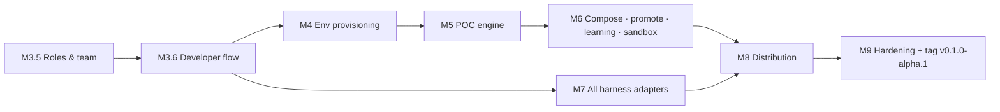

# Milestones to 0.1.0-alpha

The road from today to tagging **`v0.1.0-alpha.1`**: a signed pre-release that a PM and the developers can install with one line and use day to day.

- Each milestone follows the rule from `CLAUDE.md`: all tests green, clippy and fmt clean, docs updated, one commit.
- Milestones that touch GitHub also get an opt-in live check (like ADR-0023).

_Last updated 2026-11-17._

## Where we are

| Milestone | Status | Commit |
|---|---|---|
| M0 Skeleton (workspace, config, logging, UI kit, CI files) | ✅ done | `d1ad49b` |
| M1 MCP server, Claude Code plugin, `init` wizard, repo onboarding | ✅ done | `5384615` |
| — `self install`, connect/disconnect, `uninstall` | ✅ done | `09a1913` |
| M2 Tracker: GitHub Projects v2, sync engine, live-tested | ✅ done | `0f64711` … `41f5a86` |
| M3 PM flow (plan → breakdown → sync → status → triage), PHI guard, Claude desktop | ✅ done | `153a3a3` |
| — Fixes from the first live end-to-end run | ✅ done | `c1f4349` |

The road ahead, in order:

M7 only depends on the dev-flow skills existing, so it can run alongside M4–M6 if more hands join.

---

## M3.5 — Project-admin roles and the team list
**Plan:** [plans/roles-and-team.md](plans/roles-and-team.md) (approved) · **Size:** M

- **Roles:** the role comes from project admin (`viewerCanClose`). Only admins choose a role; everyone else, and anyone with no project yet, is `dev`. The admin check is re-run at `init`, at `tracker set` and on the daily refresh.
- **Team:** repo assignable users ∪ org members, cached per project and auto-refreshed after 24 h. Commands: `ehai team`, `ehai team refresh`, `ehai role [set]`.
- **Assignment:** `assign` / `unassign` on the tracker; MCP tools `team`, `assign_task` and `comment_task` (mentions); assignees in plans (set on create only).
- **Reporting and skills:** a "By person" status table; the `/ehai:assign` skill.

**Done when:**
- Admin and non-admin paths are tested on the fake GitHub.
- Assign/unassign and a mention comment are verified live on aisdlc-demo.
- `init` asks a non-admin one question fewer.

---

## M3.6 — Developer flow (spec §5.3)
**Size:** M · **Needs:** M3.5 (assignees)

These commands exist in the spec but haven't been built yet.

- **`/ehai:next`** suggests the next task. Order of preference: assigned to me → unblocked → priority → oldest. It asks with the top three as options.
- **`/ehai:start <#id>`**:
  - Creates branch `feat/<id>-<slug>` (the naming follows the repo profile's detected convention).
  - Never touches `main` and refuses on a dirty tree unless the user confirms.
  - Self-assigns, sets **In Progress**, and loads the task and its acceptance criteria into the session.
- **`/ehai:pr`**:
  - Drafts a PR description that links the issue (`Closes #n`), maps changed files to acceptance criteria, and includes a checklist and the repo's PR template if one exists.
  - Opens the PR **only after the user confirms**, then sets **In Review**.
- **`/ehai:done`** walks the acceptance criteria with the user, then sets **Done**.
- **New tracker capability:** linked pull requests (`Linked pull requests` field / `closingIssuesReferences`). This also feeds the status report's "open PRs" (deferred in ADR-0021).
- **New MCP tools:** `next_task`, `start_task`, `draft_pr`, `open_pr`, `finish_task`. All of them pass through the PHI guard, so nothing sensitive reaches PR text.

**Done when:**
- A git integration test on a temp repo passes: start → commit → PR draft → done. It checks that `main` and the working tree are untouched by `start` and that branch naming follows the profile.
- A live run on aisdlc-demo opens and closes a test PR.

---

## M4 — Worktree environment provisioning (spec §6)
**Size:** L · **Crate:** `ehai-env`

Every new worktree must be runnable with no manual steps.

- **Discover:**
  - gitignored config matching the known patterns (`.env*` except examples, `*.local.*`, `local.properties`, `google-services.json`, `GoogleService-Info.plist`, `.npmrc`, `.tool-versions`, `docker-compose.override.yml`, …)
  - the `[env]` include/exclude globs
  - keys referenced by `.env.example`
  - It never copies `node_modules`, `.venv`, build output or `.git`.
- **Materialise:** copy (default) or symlink (`env.strategy`). Materialised files are gitignored inside the worktree, and ehai refuses to stage them.
- **Validate:** compare keys against `.env.example`. For missing keys, ask (provide / skip / mock); values never reach logs or the AI.
- **Ports:**
  - A unique free port per worktree (`PORT`, `VITE_PORT`, Next, Metro `RCT_METRO_PORT`, Expo, Go/Python API).
  - Written to `.env.ehai.local`.
  - Tracked in `~/.ehai/ports.json` under a lock and released on discard.
  - A unique `COMPOSE_PROJECT_NAME`.
- **Install dependencies:** package manager detected from the lockfile (pnpm/yarn/npm/bun, with hardlink reuse when the lockfile matches), `go mod download`, uv/poetry/pipenv/pip with a per-worktree venv. `pod install` and Gradle are opt-in.
- **Health check:** run the configured `smoke` command (type-check, or start the server and poll the port). Report ready, or the exact failure with a fix.
- **Commands:** `ehai env sync [path]`, `ehai env check`, `ehai env doctor`, and the same as MCP tools.
- **Carry-over:** Finding 2 from ADR-0023 (a plain Node/TypeScript package should count as an app).

**Done when:**
- Fixture repos all reach "ready" in a fresh worktree: RN Expo, bare RN, Vite React, Next.js, Go API, FastAPI, pnpm monorepo. All use synthetic data only.
- Property test: ports never collide across parallel worktrees.
- Env files are never staged.
- Coverage ≥ 80 % on `ehai-env`.

---

## M5 — POC engine (spec §5.4)
**Size:** L · **Crates:** `ehai-poc`, `ehai-stack` (design tokens) · **Needs:** M4

- **Design profile:**
  - Web: Tailwind config, CSS variables, MUI/Chakra/Mantine themes, shadcn `components.json`, styled-components.
  - React Native: theme files, `StyleSheet` constants, NativeWind, react-native-paper / tamagui / restyle, fonts.
  - Also a component inventory and navigation patterns (React Router / Next routes, React Navigation / Expo Router).
  - Saved to `.ehai/cache/design-profile.json` and invalidated by file hash.
- **Worktree lifecycle:**
  - Branch `ehai/poc/<feature>/poc-<n>`, worktree at `~/.ehai/worktrees/<repo-id>/<feature>/poc-<n>`, env via M4.
  - The POC is mounted behind a preview-only route, screen or feature flag.
- **Manifest:** `.ehai/pocs/<feature>/manifest.json` holds id, parents, prompt, feedback, status, screenshots, port and env hash.
- **Preview:**
  - Start the dev server on the allocated port.
  - Screenshots through Chrome/CDP (`chromiumoxide`). For RN: Expo web, then a simulator, then Storybook, otherwise skip with a message.
- **Commands:**
  - `/ehai:poc new` and `/ehai:poc iterate` (the next number, with lineage).
  - `list`, `compare` (an HTML gallery plus a diff summary) and `open`.
  - `discard` archives to the tag `ehai-archive/<feature>/<pocN>`; nothing is hard-deleted.
- **Compliance:** mock data only; strict mode forces synthetic fixtures.

**Done when:**
- Main is never touched: the default branch, HEAD and the working tree of the source checkout are byte-identical before and after every POC operation, checked by an invariant test.
- POC new → iterate → compare → discard works on the Vite and Expo fixtures.
- Screenshots are produced when Chrome exists, and the run degrades cleanly when it doesn't.

---

## M6 — Compose, promote, learning, role-aware output, sandbox
**Size:** L · **Crates:** `ehai-poc`, `ehai-prefs`, sandbox in `ehai-core`/`ehai-env` · **Needs:** M5

- **`/ehai:poc compose "take X from poc1, Y from poc2"`:** starts from the base branch; the AI re-synthesises the parts; lineage is recorded per parent.
- **`/ehai:poc promote`:** only on an explicit command, after confirming in the question UI, it opens a PR to the default branch. Afterwards it asks whether to archive the rest.
- **Profiles:**
  - Global profile at `~/.ehai/prefs/user.toml`.
  - Repo profile with **team decisions** (committed) plus personal `project.local.toml` (gitignored).
  - Resolution order: team decision > user explicit > repo observed > user observed > default.
- **Preference learning:**
  - Signals are POC likes and promotions, recurring feedback themes, planning style and repeated answers.
  - Each record is `{key, value, scope, evidence, confidence, source, first_seen, last_seen}`; confidence decays over time.
  - Used through `ehai://prefs` and injected into prompts.
  - `/ehai:prefs` can edit, pin, delete and reset; `prefs.learning = false` turns learning off.
- **Role-aware output end to end:**
  - PM in the Claude Code CLI opens the HTML report.
  - Plain language for PMs, technical for devs.
  - Next options always go through the question UI.
- **Sandbox (spec §9A):**
  - `restricted` (default) uses Landlock (+ bubblewrap) on Linux, `sandbox-exec` on macOS, and a job object on Windows, always with path enforcement inside ehai.
  - `container` uses Docker/Podman or the repo's devcontainer.
  - Worktree-scoped Claude Code permissions are written for POC sessions.
  - `doctor` reports any fallback.
- **Carry-over:** whether ZIP skill export for Claude desktop is wanted (ADR-0022).

**Done when:**
- A blocked-command test suite and escape attempts (path traversal, symlink escapes) pass.
- Preferences visibly change later output (tested).
- Compose and promote are verified on a fixture repo, and promote is verified live on aisdlc-demo.

---

## M7 — All harness adapters (spec §10)
**Size:** M · **Can run in parallel with M4–M6**

| Harness | MCP registration | Commands |
|---|---|---|
| Codex CLI | `~/.codex/config.toml` `[mcp_servers]` (marked block) | custom prompts dir |
| Gemini CLI | `~/.gemini/settings.json` `mcpServers` | `~/.gemini/commands/*.toml` |
| Cursor | `~/.cursor/mcp.json` | user commands |
| OpenCode | its config | its commands dir |
| VS Code / Copilot | user `mcp.json` | prompt files |
| Windsurf | its MCP config | workflows |
| Anything else | — | global `AGENTS.md` snippet |

- Every path and format is **verified against current docs** first, with the source and date recorded in DECISIONS.
- Every adapter is idempotent and reversible, with marked blocks or exact keys and a backup before the first edit.
- `regenerate` runs automatically after updates and name changes.
- `init` pre-checks all detected harnesses. Your machine has Codex, Gemini, Cursor, OpenCode, VS Code and Windsurf.

**Done when:**
- Snapshot tests per harness and per brand name pass.
- Install → regenerate → remove leaves no trace (tested in a sandboxed HOME).
- Slash commands work in Claude Code and **at least two more harnesses** (spec §14), checked by hand.

---

## M8 — Distribution
**Size:** M · **Crate:** `ehai-update` · **Needs:** decisions D1–D3 below

- **`install/install.sh` and `install.ps1`:**
  - Authenticate with `gh auth token`, falling back to `GITHUB_TOKEN`.
  - Download the right release asset, verify the checksum and minisign signature, then run `ehai self install` and `ehai init`.
  - Honour `EHAI_NAME`.
  - On Windows, set the user PATH.
- **Release workflow:** first real run (cross-compile, SHA256SUMS, minisign, git-cliff notes, pre-release flag), plus the `just release` recipe.
- **`ehai update`:**
  - Staging download → verify → keep `ehai.prev` → atomic swap → `doctor --post-update` → **automatic rollback** if doctor fails.
  - `ehai update --rollback`; channels `alpha` → `beta` → `stable`.
  - A daily check that only notifies (`update.check`).
- **Config migration test:** take any v1 config to the latest version, simulating a v2 schema.
- **First push:** push the repo, check that CI runs (path filters, the `ci-skip` mirror), and confirm a doc-only commit triggers no real CI.

**Done when:**
- An update test simulates a failed post-update doctor, and rollback restores the previous binary and config.
- One-line install works on Linux (your machine). macOS and Windows are checked through CI artifacts and a manual run.

---

## M9 — Hardening and release
**Size:** M

- **End-to-end suite (`tests/e2e`):** install from a local release → `init --yes` → sync to the fake tracker → POC on the RN and Vite fixtures → compose → discard → uninstall leaves no trace.
- **Live suite:** move the live PM-flow script from ADR-0023 into `tests/e2e/live_pm_flow.py` (opt-in, `EHAI_LIVE_GH=1`), with the aisdlc-demo clean-up step built in.
- **Docs:**
  - README
  - **PM quick start** with screenshots (Claude desktop and the Claude Code CLI)
  - dev guide
  - config reference (generated from the JSON schema)
  - troubleshooting
- **Performance:** `init` under 2 minutes with at most about 5 questions, a fast `ehai mcp` start, a fast `status` on a 500-item board.
- **Security review:** token handling, guard coverage, sandbox, `cargo deny`.
- **Tag `v0.1.0-alpha.1`** → a signed pre-release on the release repo.

---

## Spec §14 "definition of done" → where it's covered

| Requirement | Milestone |
|---|---|
| One-line install on macOS, Linux and Windows from the private repo | M8 |
| Slash commands in Claude Code + ≥ 2 other harnesses; PM flows in Claude desktop | M1, M3 ✅ · M7 |
| PM: idea → PRD → approved breakdown → GitHub items with no terminal work beyond setup | M3 ✅ |
| POCs run out of the box, match the design system, iterate and compose, never touch main | M4, M5, M6 |
| Preferences visibly change output and are user-editable | M6 |
| Updates never break the install; rollback proven by tests | M8 |
| `init` under 2 minutes, about 5 questions | M3.5 (fewer questions for devs), M9 (measured) |
| PM flow works from Claude desktop **and** the Claude Code CLI | M3 ✅ · M6 (CLI report opening) |
| Output follows learned global and repo preferences | M6 |
| Doc-only commits trigger no CI; tag → signed pre-release | M8, M9 |

## Decisions needed from you

| # | Question | Needed by |
|---|---|---|
| D1 | `jagadeeshm007/ehai` is **public** and empty; the spec says releases come from a **private** repo. Make it private before the first push? | M8 (first push) |
| D2 | Generate the minisign key (`minisign -G -W`) and add the `MINISIGN_KEY` secret to the release repo | M8 |
| D3 | An OAuth app for GitHub device-flow login (ADR-0017): who registers it, under which org? Without it, ehai keeps using `gh` / `GITHUB_TOKEN` | M8 (optional for alpha) |
| D4 | Which harnesses must be in the "≥ 2 others" acceptance check? Suggested: Codex CLI and Cursor | M7 |
| D5 | Which fixture apps should the POC engine be judged on? Suggested: a Vite React app and an Expo app (synthetic data) | M5 |

## Known risks

- **Harness formats change often.** M7 re-verifies each one against its docs, and snapshot tests catch drift.
- **Sandboxing differs by OS.** Landlock needs Linux 5.13 or later (ADR-0007), and macOS `sandbox-exec` is deprecated but still works. `doctor` must report the fallback clearly.
- **RN screenshots depend on Expo web or a simulator.** The engine degrades to "no screenshot" with a clear message.
- **Live GitHub surprises:** the live runs caught 4 bugs the fakes missed (ADR-0018/19/23). Every milestone that touches GitHub ends with a live check.
